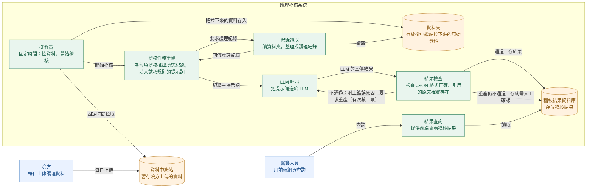

# 系統架構圖

> 狀態：草稿。元件的程式名稱為目標設計，尚未與後端現有模組（`services/audit`、`services/ingestion`、`services/llm/gateway.py`）逐一對照；分層與 import 限制見 [architecture.md](conventions/architecture.md)。

## 說明

一天的流程如下：

1. 院方把當天的護理資料上傳到資料中繼站。
2. 護理稽核系統的排程器在固定時間，先到中繼站拉資料、存進系統的資料夾，再開始稽核。
3. 稽核任務準備向紀錄讀取要護理紀錄；紀錄讀取讀資料夾，整理後回傳。
4. 每項稽核規則挑出所需紀錄，填入該項規則的提示詞，再交給大型語言模型（LLM）分析。
5. LLM 的回傳結果經檢查：通過就存進稽核結果資料庫；不通過就附上錯誤原因要求重產，超過次數上限仍不通過，存成「需人工確認」，不當作正常。
6. 醫護人員在前端網頁查詢稽核結果。

## 架構圖

圖例：藍色＝系統外的人或單位；綠色＝系統內的處理元件；橘色＝存放資料的地方。

## 名詞對照

| 圖上名稱 | 程式元件名（暫定） | 做什麼 |
|---|---|---|
| 排程器 | Scheduler | 固定時間觸發兩件事：拉資料、開始稽核 |
| 紀錄讀取 | RecordGateway | 讀資料夾，轉成統一格式的護理紀錄 |
| 稽核任務準備 | AuditTaskBuilder | 每項稽核各自挑紀錄、填入提示詞 |
| LLM 呼叫 | LLMGateway | 唯一送出 LLM 請求的地方 |
| 結果檢查 | ResultValidator | 檢查 JSON 格式，並確認 LLM 引用的原文確實出現在對應紀錄裡 |
| 結果查詢 | ResultQuery API | 前端查詢稽核結果的介面 |

名詞說明：
- **提示詞（Prompt）**：給 LLM 的書面指示，由專案內每項規則各一份的模板填入資料而成，另外會先帶上全系統共用的一段指示（共用 system prompt，見 [llm.md](conventions/llm.md)）。內容包含：
  1. 角色：只做紀錄一致性與完整性檢查，不做臨床判斷
  2. 這項規則要檢查什麼，以及什麼情況算不一致
  3. 該項要稽核的護理紀錄，每筆標明來源與紀錄 ID
  4. 要求的回傳格式（JSON）
  5. 限制：只根據提供的資料判斷、每個結論都要引用原文、資料不足就回「需人工確認」
- **JSON**：程式之間交換資料的文字格式，這裡指 LLM 回傳的稽核結果。
- **需人工確認（NEEDS_REVIEW）**：系統無法判定，交給護理師確認；不等於通過，也不等於有錯。

### 例：結果檢查不通過時

| 步驟 | 發生什麼 |
|---|---|
| 輸入 | LLM 回傳的內容缺少「引用原文」欄位 |
| 檢查 | 格式不符，不通過 |
| 處理 | 把錯誤原因（缺少哪個欄位）附在提示詞後，要求 LLM 重產；次數上限由設定決定 |
| 重產後通過 | 存進稽核結果資料庫 |
| 重產仍不通過 | 存成「需人工確認」，結果頁顯示請護理師確認 |
| 引用的原文在該紀錄裡找不到 | 丟棄這筆 Evidence；一筆有效的都沒有，就存成「需人工確認」 |

## 待確認

| 項目 | 狀態 |
|---|---|
| 稽核項目有幾項、是哪些（對照 [audit-rules.md](conventions/audit-rules.md)，R08–R11 為候選） | 待確認 |
| 程式元件名與後端現有模組的對應 | 待確認 |
| 中繼站的傳輸方式與認證 | 待決（見 CLAUDE.md） |
| 資料夾位置與內容的存放規範（不得 commit，見 CLAUDE.md） | 待確認 |
| 前端顯示 Evidence 時，病患摘要與原文片段從哪取得（結果查詢目前只讀稽核結果） | 圖上未畫出 |
| 格式檢查現行規範放在 LLM 呼叫內（llm.md 步驟 5），圖上拆成獨立的「結果檢查」；兩者要統一 | 待確認 |
| 可用程式判斷的規則是否不經 LLM（核心原則 4） | 圖上未畫出 |
